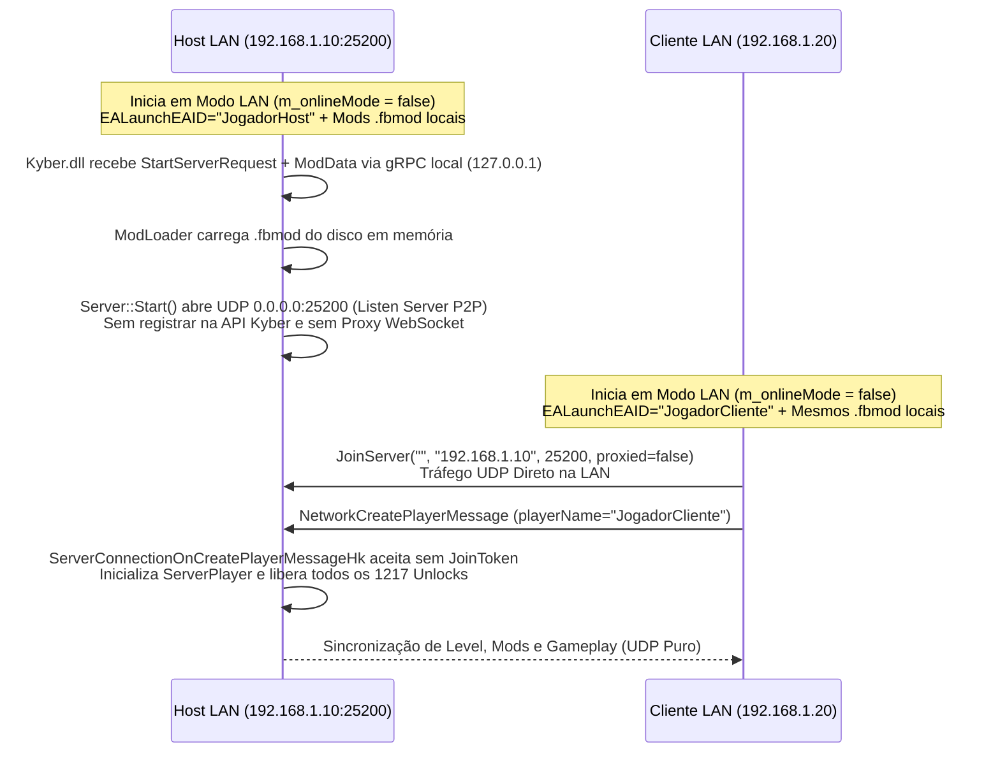

# Análise Técnica: Modo LAN Puro / P2P no KYBER (Sem Backend Central / Offline)

## 1. Resumo Executivo (É possível?)

A resposta curta se divide em **duas camadas independentes** da arquitetura do jogo e do KYBER:

| Camada | O que ela controla | É possível rodar em LAN Puro / Sem Conta? |
| :--- | :--- | :--- |
| **1. Rede Multiplayer, Hospedagem (P2P / Listen Server ou Dedicado), Mods e Autenticação KYBER** | Conexão entre jogadores (UDP direto), criação de partida local (Host P2P), desbloqueio de itens/cartas (Star Cards/Armas), carregamento de mods Frosty e navegador/conexão por IP. | **SIM (100% viável).** Cerca de **70% do suporte a LAN direto já existe no código-fonte** (`KYBER_ONLINE_MODE=0`, comando `Kyber.JoinServer <ip> <port>`, sockets UDP nativos sem proxy e Host In-Process). Basta desacoplar a inicialização do `Kyber.dll` e do `CLI`/`Launcher` da API central (`api-rpc.prod.kyber.gg`). |
| **2. Inicialização do Executável (`starwarsbattlefrontii.exe`) — DRM da EA (OOA + Denuvo)** | Validação de posse do jogo pela engine Frostbite antes de abrir a janela do jogo, via protocolo local **LSX** (Origin SDK) e arquivo de licença `1035052.dlf`. | **Parcial (Offline com Cache vs. Zero Conta EA):**<br>• **Com licença/token em cache (Offline Mode):** **SIM**, o Maxima já prevê cache de `.dlf` e variável `MAXIMA_DENUVO_TOKEN`, permitindo jogar em LAN 100% desconectado da internet após o token do hardware existir.<br>• **Sem nunca ter tido conta EA (Zero Licença):** **NÃO apenas pelo código do Kyber**, pois a exigência do token Denuvo/OOA está compilada dentro do binário proprietário `starwarsbattlefrontii.exe`, e não no Kyber. |

---

## 2. Arquitetura Atual do KYBER (Como funciona hoje)

O monorepo clonado divide-se em 6 componentes principais:

1. **`Module/` (`Kyber.dll` em C++)**: DLL injetada no processo do `starwarsbattlefrontii.exe`. Faz hooks na engine Frostbite (via MinHook), substitui o gerenciador de sockets de rede, gerencia o carregamento de mods (`.fbmod`), destrava todos os itens na memória e expõe um servidor gRPC local (`InterfaceService`).
2. **`ThirdParty/Maxima/` (`maxima-lib` em Rust)**: Substituto open-source do EA App / Origin. Inicia um servidor TCP local **LSX** (porta dinâmica passada via `EALsxPort`) para conversar com o Origin SDK embutido no executável do jogo, gerencia o arquivo de licença `.dlf` (`Origin Online Activation`) e injeta a `Kyber.dll`.
3. **`CLI/` e `Launcher/` (Dart / Flutter + Rust Bridge)**: Frontends que fazem login na EA (via Maxima), trocam o token da EA por um `KYBER_API_TOKEN` na nuvem do Kyber, sobem um servidor gRPC local (`KYBER_LAUNCHER_PORT`) para passar os parâmetros de inicialização (`InitializeRequest`) para a `Kyber.dll` e iniciam o jogo.
4. **`API/` (Go) e `Proxy/` (Rust)**: Infraestrutura central do Kyber (autenticação EA/Patreon, lista de servidores, tokens de entrada `JoinToken`, proxies WebSocket e estatísticas). **No modo LAN puro/P2P, tanto `API/` quanto `Proxy/` podem ser totalmente eliminados.**

```mermaid
flowchart TD
    subgraph Maquina_Local ["Máquina do Jogador / Host LAN"]
        Launcher["Launcher / CLI (Dart + Maxima Rust)"]
        LSX["Servidor Local LSX (127.0.0.1:EALsxPort)"]
        LauncherGRPC["Servidor gRPC Local (127.0.0.1:KYBER_LAUNCHER_PORT)"]
        
        subgraph GameProcess ["Processo: starwarsbattlefrontii.exe"]
            Frostbite["Engine Frostbite + Origin SDK + Denuvo"]
            KyberDLL["Kyber.dll (C++ Module)"]
            UDPSocket["Kyber UDPSocket (UDP :25200)"]
        end
    end

    subgraph Nuvem_Externa ["Dependências Externas Atuais (Internet)"]
        EA["Servidores EA (OAuth + OOA License / Denuvo Token)"]
        KyberAPI["Kyber Cloud API (api-rpc.prod.kyber.gg)"]
        KyberProxy["Kyber WebSocket Proxy"]
        Vivox["Vivox VoIP Cloud"]
    end

    Launcher <-->|"1. Login OAuth & Licença"| EA
    Launcher <-->|"2. Troca Token EA por KYBER_API_TOKEN"| KyberAPI
    Frostbite <-->|"3. Handshake LSX & RequestLicense"| LSX
    KyberDLL <-->|"4. Initialize() gRPC Local"| LauncherGRPC
    KyberDLL <-->|"5. Registro de Server / JoinToken / Stats"| KyberAPI
    KyberDLL <-->|"6. Login VoIP"| Vivox
    UDPSocket <-->|"7a. Modo Proxied (WebSocket)"| KyberProxy
    UDPSocket <-->|"7b. Modo Direct / LAN (UDP Puro)"| PeerUDP["Outro Jogador na LAN (UDP Direto)"]
```



---

## 3. O que JÁ EXISTE no Código para LAN Puro / P2P

A análise do código-fonte em `Module/` revela que os desenvolvedores do Kyber **já construíram a base para conexões diretas (P2P / Listen Server e Dedicado) e modo offline**:

### 3.1. Hospedagem P2P (Listen Server / In-Process Host)
O Battlefront II (2017) suporta rodar o servidor e o cliente **dentro do mesmo processo** (o jogador que cria a sala é o Host P2P, escutando na porta UDP `25200`, enquanto os outros conectam diretamente no IP dele):
- Em [`Server::Start()`](file:///c:/Users/jomac/Desktop/nc/KyberLAN/Module/Source/Core/Server.cpp#L188-L240):
  - Configura `networkSettings->ServerPort = 25200` e `m_runningHosted = true`.
  - Inicia a simulação de servidor junto com o cliente gráfico (`!g_program->m_isDedicatedServer`), permitindo que o próprio Host jogue na partida sem precisar de um servidor dedicado separado.
- Além disso, [`Program::InitializeGamePatches()`](file:///c:/Users/jomac/Desktop/nc/KyberLAN/Module/Source/Core/Program.cpp#L843) aplica um patch (`NOP` em `0x14018B133`) que permite abrir **múltiplas instâncias do jogo na mesma máquina** (excelente para testar LAN local ou rodar servidor dedicado + cliente no mesmo PC).

### 3.2. Sockets UDP Nativos (Zero Proxy)
Em [`UDPSocket.cpp`](file:///c:/Users/jomac/Desktop/nc/KyberLAN/Module/Source/Network/UDPSocket.cpp):
- **`UDPSocket::Send`** ([linhas 75–137](file:///c:/Users/jomac/Desktop/nc/KyberLAN/Module/Source/Network/UDPSocket.cpp#L75-L137)): Só encapsula pacotes via WebSocket Proxy se `m_info.isProxied == true` ou se o IP do cliente começar com a faixa virtual `0.1.1.x`. Caso contrário, executa `sendto(m_socketHandle, ...)` puro via Winsock UDP diretamente para o IP:Porta da LAN!
- **`UDPSocket::ReceiveFromWhen`** ([linhas 139–206](file:///c:/Users/jomac/Desktop/nc/KyberLAN/Module/Source/Network/UDPSocket.cpp#L139-L206)): Lê diretamente do socket UDP via `recvfrom(m_socketHandle, ...)`.
- **`UDPSocket::Listen`** ([linhas 241–266](file:///c:/Users/jomac/Desktop/nc/KyberLAN/Module/Source/Network/UDPSocket.cpp#L241-L266)): Se `m_info.isProxied == false` e `g_program->m_server->m_onlineMode == false`, o socket faz apenas `bind()` na porta UDP local (`0.0.0.0:25200`) e **não abre nenhuma conexão WebSocket com proxies externos**.

### 3.3. Flag `KYBER_ONLINE_MODE=0` (Bypass de JoinToken no Servidor e Cliente)
Em [`Server.cpp`](file:///c:/Users/jomac/Desktop/nc/KyberLAN/Module/Source/Core/Server.cpp#L49-L58), já existe a função `IsOnlineMode()`:
```cpp
static bool IsOnlineMode()
{
    const char* onlineMode = std::getenv("KYBER_ONLINE_MODE");
    if (onlineMode != nullptr)
    {
        return std::string(onlineMode) == "1";
    }
    return true;
}
```
Quando `KYBER_ONLINE_MODE=0` (`m_onlineMode == false`):
1. **No Cliente** ([`Client::HandleClientServerJoin`](file:///c:/Users/jomac/Desktop/nc/KyberLAN/Module/Source/Core/Client.cpp#L37-L57)): O cliente **não** sobrescreve o `playerName` com `"KyberAuthentication:" + m_joinToken`. Ele envia o pacote `NetworkCreatePlayerMessage` com o nome nativo do jogador (definido na variável de ambiente `EALaunchEAID`).
2. **No Servidor** ([`ServerConnectionOnCreatePlayerMessageHk`](file:///c:/Users/jomac/Desktop/nc/KyberLAN/Module/Source/Core/Server.cpp#L641-L654)):
   ```cpp
   if (!g_program->m_server->m_onlineMode)
   {
       KYBER_LOG(Info, "[Server] " << message->playerName << " joined (Spectator: " << message->isSpectator << ")");
       return trampoline(inst, message);
   }
   ```
   O servidor **ignora completamente** a validação de token (`ConsumeJoinToken`) na API do Kyber e aceita a conexão do jogador imediatamente na LAN!

### 3.4. Conexão Direta por IP:Porta (`Kyber.JoinServer`)
- Em [`Client::JoinServer`](file:///c:/Users/jomac/Desktop/nc/KyberLAN/Module/Source/Core/Client.cpp#L80-L124): Quando `id` é vazio (`""`) e `proxied` é `false`, o método **não consulta o ServerBrowser da API**; ele define diretamente `ClientSettings->ServerIp = ip` e `NetworkSettings->ServerPort = port` e inicia a conexão!
- Em [`Console.cpp`](file:///c:/Users/jomac/Desktop/nc/KyberLAN/Module/Source/Core/Console.cpp#L684-L693): O comando de console in-game `Kyber.JoinServer <ip> <port>` **já está implementado**:
  ```cpp
  void JoinServerCommand(ConsoleContext& cc)
  {
      auto stream = cc.stream();
      std::string ip;
      uint16_t port;
      stream >> ip >> port;

      cc << "Connecting to " << ip << ":" << port << "...";
      g_program->m_client->JoinServer("", ip, port, "", false);
  }
  ```

### 3.5. Todos os Itens/Armas/Cartas Desbloqueados Localmente
Em [`PersistenceManager.cpp`](file:///c:/Users/jomac/Desktop/nc/KyberLAN/Module/Source/Persistence/PersistenceManager.cpp#L78-L108), o hook `InitUnlockArrayHk` intercepta a inicialização de desbloqueios do jogador no servidor e ativa todos os 1.217 bits (`bitArray->SetAllBits()`). Isso significa que **mesmo sem os servidores da EA (Blaze) e sem o banco de dados de estatísticas do Kyber**, todos os jogadores na LAN têm todas as armas, heróis e Star Cards desbloqueados localmente na memória.

---

## 4. O que Impede o Modo LAN Puro Hoje (Bloqueios no Código)

Apesar de toda a camada de rede UDP e `KYBER_ONLINE_MODE=0` existir, tentar rodar o Kyber offline hoje falha por **5 bloqueios específicos** no código:

### Bloqueio 1: Exigência obrigatória de `KYBER_API_TOKEN` na `Kyber.dll`
Em [`Program::InitializationThread()`](file:///c:/Users/jomac/Desktop/nc/KyberLAN/Module/Source/Core/Program.cpp#L212-L221):
```cpp
const char* apiToken = std::getenv("KYBER_API_TOKEN");
if (apiToken == nullptr)
{
    ErrorUtils::ThrowException("No API token specified");
    return;
}
m_api = std::make_unique<API>(apiToken);
```
Mesmo que `KYBER_ONLINE_MODE=0`, se `KYBER_API_TOKEN` não estiver definido, a DLL fecha o jogo com erro fatal. Além disso, `new API(apiToken)` ([`API.cpp`](file:///c:/Users/jomac/Desktop/nc/KyberLAN/Module/Source/RPC/API.cpp#L73-L94)) cria imediatamente um canal gRPC tentando conectar em `api-rpc.prod.kyber.gg`.

### Bloqueio 2: Bug em `Server::Start()` que força `Register(true)` ignorando `m_onlineMode`
Em [`Server::Start()`](file:///c:/Users/jomac/Desktop/nc/KyberLAN/Module/Source/Core/Server.cpp#L221):
```cpp
g_program->m_server->Register(true); // force = true!
```
E em [`Server::Register(bool force, bool reuseId)`](file:///c:/Users/jomac/Desktop/nc/KyberLAN/Module/Source/Core/Server.cpp#L772-L809):
```cpp
if (!force && (!IsRunning() || !m_creationInfo || !m_onlineMode))
{
    return;
}
```
Como `Server::Start()` passa `force = true`, um Host P2P (Listen Server) **ignora** `KYBER_ONLINE_MODE=0` e tenta registrar o servidor na API central do Kyber em loop infinito a cada 0.5s! (Já no servidor dedicado em [`Program.cpp:596`](file:///c:/Users/jomac/Desktop/nc/KyberLAN/Module/Source/Core/Program.cpp#L596), ele checa `if (g_program->m_server->m_onlineMode)` antes de chamar `Register()`).

### Bloqueio 3: Inicialização de Jogador no Servidor quando `m_onlineMode == false`
Em [`ServerConnectionOnCreatePlayerMessageHk`](file:///c:/Users/jomac/Desktop/nc/KyberLAN/Module/Source/Core/Server.cpp#L649-L653):
Quando `m_onlineMode == false`, a função retorna `trampoline(inst, message)` diretamente, pulando a inicialização de `player->m_onlineId`, `InitializePlayer(player)` e o disparo do evento Lua `ServerPlayer:Joined` ([linhas 696–725](file:///c:/Users/jomac/Desktop/nc/KyberLAN/Module/Source/Core/Server.cpp#L696-L725)). Precisamos executar a inicialização local do `ServerPlayer` (gerando um `userId` determinístico a partir do hash do `playerName`) logo após o `trampoline(inst, message)` quando `m_onlineMode == false`.

### Bloqueio 4: Chamadas diretas a `GetAPI()` sem checar `m_onlineMode`
Em alguns pontos de `Module/`, `g_program->GetAPI()` é chamado mesmo se o servidor estiver em modo offline:
- [`VoipManager::RequestLogin()`](file:///c:/Users/jomac/Desktop/nc/KyberLAN/Module/Source/Voip/VoipManager.cpp#L169-L191): Tenta fazer login no Vivox via API Kyber ao criar o cliente.
- [`PersistenceManager::LoadPlayerStats` / `SavePlayerStats`](file:///c:/Users/jomac/Desktop/nc/KyberLAN/Module/Source/Persistence/PersistenceManager.cpp#L110-L122): Tenta carregar/salvar estatísticas na API quando `m_isDedicatedServer == true`.
- [`Server::SendConsoleMessage`](file:///c:/Users/jomac/Desktop/nc/KyberLAN/Module/Source/Core/Server.cpp#L1006-L1014), [`ServerPlayerSetTeamIdHk`](file:///c:/Users/jomac/Desktop/nc/KyberLAN/Module/Source/Core/Server.cpp#L474-L483) e [`MessageManagerDispatchMessageHk`](file:///c:/Users/jomac/Desktop/nc/KyberLAN/Module/Source/Core/Program.cpp#L424-L446): Chamam `GetServerManagement()->SendPlayerList()` e `SendConsoleMessage()`.

### Bloqueio 5: Login Obrigatório na EA e na API Kyber no `CLI` e `Launcher` + `LaunchMode::Offline` incompleto no `Maxima`
1. Em [`CLI/lib/commands/start_game.dart`](file:///c:/Users/jomac/Desktop/nc/KyberLAN/CLI/lib/commands/start_game.dart#L57-L103) e [`Launcher/lib/features/maxima/helper/maxima_helper.dart`](file:///c:/Users/jomac/Desktop/nc/KyberLAN/Launcher/lib/features/maxima/helper/maxima_helper.dart#L150-L153): O fluxo exige login OAuth na EA (`loginFlow()`) e chamada gRPC para `service.getAuthToken(authToken)` na nuvem do Kyber antes de iniciar o jogo.
2. Em [`ThirdParty/Maxima/maxima-lib/src/core/launch.rs`](file:///c:/Users/jomac/Desktop/nc/KyberLAN/ThirdParty/Maxima/maxima-lib/src/core/launch.rs#L92-L100):
   O enum `LaunchMode::Offline(String)` já foi declarado pelos autores:
   ```rust
   pub enum LaunchMode {
       /// Completely offline, relies on cached license files and user IDs
       Offline(String), // Offer ID
       Online(String),
       OnlineOffline(String, String, String),
   }
   ```
   Porém, nas linhas [214](file:///c:/Users/jomac/Desktop/nc/KyberLAN/ThirdParty/Maxima/maxima-lib/src/core/launch.rs#L214) e [347](file:///c:/Users/jomac/Desktop/nc/KyberLAN/ThirdParty/Maxima/maxima-lib/src/core/launch.rs#L347), o branch `LaunchMode::Offline` ainda está com `return Err(LaunchError::Offline)` e `todo!()`.

---

## 5. A Questão da Conta EA / Origin (Análise Profunda de DRM vs. LAN)

É fundamental entender por que o `starwarsbattlefrontii.exe` interage com o Maxima no momento do boot:

1. **O que o executável do jogo exige ao abrir:**
   - O binário oficial `starwarsbattlefrontii.exe` possui **Origin Online Activation (OOA)** + **Denuvo**.
   - Ao iniciar, o jogo lê o arquivo de licença cifrado em `C:\ProgramData\Electronic Arts\EA Services\License\1035052.dlf` ([`ooa/mod.rs`](file:///c:/Users/jomac/Desktop/nc/KyberLAN/ThirdParty/Maxima/maxima-lib/src/ooa/mod.rs#L43)) e conecta via TCP local na porta `EALsxPort` ([`Program.cpp:335`](file:///c:/Users/jomac/Desktop/nc/KyberLAN/Module/Source/Core/Program.cpp#L335)) enviando comandos XML (`<LSX>`).
   - Durante o boot, o executável envia `<RequestLicense RequestTicket="..." TicketEngine="..."/>` ([`license.rs:15-64`](file:///c:/Users/jomac/Desktop/nc/KyberLAN/ThirdParty/Maxima/maxima-lib/src/lsx/request/license.rs#L15-L64)) esperando de volta um `game_token` Denuvo válido para o hash de hardware daquela máquina.

2. **Como funciona o Modo Offline / Cache no Maxima:**
   - Observe [`ThirdParty/Maxima/maxima-lib/src/lsx/request/license.rs`](file:///c:/Users/jomac/Desktop/nc/KyberLAN/ThirdParty/Maxima/maxima-lib/src/lsx/request/license.rs#L21-L23):
     ```rust
     if let Ok(token) = env::var("MAXIMA_DENUVO_TOKEN") {
         return make_lsx_handler_response!(Response, RequestLicenseResponse, { attr_License: token.to_owned() });
     }
     ```
   - E em [`CLI/lib/commands/start_server_command.dart`](file:///c:/Users/jomac/Desktop/nc/KyberLAN/CLI/lib/commands/start_server_command.dart#L273-L308), o próprio Kyber CLI já captura o `Got Denuvo Token: ...` do log do Maxima e o reutiliza via `MAXIMA_DENUVO_TOKEN` juntamente com o arquivo `1035052.dlf`!
   - Além disso, o Maxima já possui o modo `dummy_local_user(true)` ([`maxima-lib/src/core/mod.rs:166-202`](file:///c:/Users/jomac/Desktop/nc/KyberLAN/ThirdParty/Maxima/maxima-lib/src/core/mod.rs#L166-L202)), que cria um usuário local (`DummyUser`) sem consultar a API GraphQL da EA, e usa a variável de ambiente `EALaunchEAID` ([`Program.cpp:668`](file:///c:/Users/jomac/Desktop/nc/KyberLAN/Module/Source/Core/Program.cpp#L668)) como o **Nickname do jogador** dentro do jogo!

3. **Conclusão sobre a Conta EA:**
   - **No código do Kyber/Maxima (sem modificar o `.exe` proprietário do jogo):**
     - O executável original `starwarsbattlefrontii.exe` precisa que o arquivo `1035052.dlf` e o `MAXIMA_DENUVO_TOKEN` existam para o hardware atual (gerados em uma primeira execução online) **ou** que o binário do jogo já não exija validação OOA/Denuvo.
     - Uma vez que o processo do jogo está rodando, **nenhuma conta EA, nenhum servidor da EA e nenhuma conta Kyber são necessários para criar salas, entrar por IP na LAN, escolher o nickname (`EALaunchEAID`) e jogar P2P com mods**.

---

## 6. Como Funciona o Sistema de Mods (Local vs. API Kyber vs. Site Externo)

O sistema de Mods no Kyber é dividido em **3 partes distintas**. A boa notícia para uma versão **100% LAN permanente** é que todo o motor de leitura, mesclagem e injeção de mods no jogo já é **100% local e offline**:

### 6.1. Carregamento e Execução dos Mods no Jogo (`Kyber.dll` + `ModService`) — 100% Local / Offline
- **Formato de Arquivo:** O Kyber carrega arquivos `.fbmod` (Frosty Mod) e coleções `.kbcollection` / `.fbcollection` armazenados em uma pasta local no disco.
- **Leitura de Metadados e Mapas Customizados (Offline):**
  - Tanto o [`ModService`](file:///c:/Users/jomac/Desktop/nc/KyberLAN/Launcher/lib/features/mods/services/mod_service.dart#L233-L372) (no Launcher) quanto o [`ModHelper`](file:///c:/Users/jomac/Desktop/nc/KyberLAN/CLI/lib/utils/mod_helper.dart) (no CLI) usam o pacote local `kyber_collection` (`ModReader`, `FrostyCollectionReader`) para ler diretamente os cabeçalhos binários dos arquivos `.fbmod` no disco.
  - Mapas e modos de jogo customizados (Custom Levels) também são extraídos localmente de dentro do próprio binário `.fbmod` via [`LevelDeclarationService`](file:///c:/Users/jomac/Desktop/nc/KyberLAN/Launcher/lib/features/mods/services/level_declaration_service.dart).
- **Passagem para o Jogo (gRPC Local `127.0.0.1`):**
  - Quando o jogo inicia, a `Kyber.dll` chama [`LauncherInterface::Initialize()`](file:///c:/Users/jomac/Desktop/nc/KyberLAN/Module/Source/RPC/API/Launcher.cpp#L20-L120) conectando-se ao servidor gRPC local (`127.0.0.1:KYBER_LAUNCHER_PORT`).
  - O Launcher/CLI responde localmente com a lista de caminhos dos `.fbmod` (`basePath`, `modPaths`, `mods` e `explodedMods`).
- **Injeção na Engine Frostbite (`ModLoader.cpp`):**
  - No hook [`FileSuperBundleManagerUpdateConfigHk`](file:///c:/Users/jomac/Desktop/nc/KyberLAN/Module/Source/Core/Program.cpp#L691-L703), a `Kyber.dll` instancia [`ModLoader`](file:///c:/Users/jomac/Desktop/nc/KyberLAN/Module/Source/ModLoader/ModLoader.cpp), que aplica `BundleMerger`, `ManifestMerger`, `ResourceMerger`, `EBX` e `Chunks` **100% em memória a partir dos arquivos locais**, sem fazer **nenhuma** chamada à API do Kyber ou à internet.
  - *(Nota)*: Existe um método [`ClientServerAPI::GetBlacklist()`](file:///c:/Users/jomac/Desktop/nc/KyberLAN/Module/Source/RPC/API/ClientServer.cpp#L44-L67) no código C++, mas ele **não é chamado em nenhum lugar** do módulo.

### 6.2. Onde o Launcher chama a API do Kyber por causa de Mods (O que precisamos remover no Modo LAN)
Existem **2 pontos** no Launcher (`Launcher/`) que consultam a API do Kyber ao lidar com mods:
1. **`getPreloadedMods` ao iniciar o jogo (Bloqueio se estiver offline):**
   - Em [`MaximaHelper.requestGameLaunch()`](file:///c:/Users/jomac/Desktop/nc/KyberLAN/Launcher/lib/features/maxima/helper/maxima_helper.dart#L59-L66) e [`PreloadedModsHelper.preloadMods()`](file:///c:/Users/jomac/Desktop/nc/KyberLAN/Launcher/lib/features/mods/helper/preloaded_mods_helper.dart#L14-L66), o Launcher chama `sl.get<KyberGRPCService>().launcherClient.getPreloadedMods(Empty())` na API do Kyber **sem `try/catch`** para baixar mods pré-carregados da nuvem (S3) e descontar do limite de `1739` mods da engine:
     ```dart
     final preloadedMods = await sl
         .get<KyberGRPCService>()
         .launcherClient
         .getPreloadedMods(Empty());
     var modLimit = 1739 - preloadedMods.mods.length;
     ```
   - **Solução para a versão Sempre LAN:** Remover a chamada `getPreloadedMods` em [`maxima_helper.dart`](file:///c:/Users/jomac/Desktop/nc/KyberLAN/Launcher/lib/features/maxima/helper/maxima_helper.dart#L59-L66) e [`preloaded_mods_helper.dart`](file:///c:/Users/jomac/Desktop/nc/KyberLAN/Launcher/lib/features/mods/helper/preloaded_mods_helper.dart#L14-L66), mantendo fixo `const modLimit = 1739;`.
2. **Resolução de links de download ao entrar em servidor (`ModBridgeService` / `DownloadLinkResolver`):**
   - Quando um jogador clica para entrar em um servidor com mods ([`KyberServerHelper.joinServer`](file:///c:/Users/jomac/Desktop/nc/KyberLAN/Launcher/lib/features/kyber/helper/kyber_server_helper.dart#L32-L64)), o Launcher verifica localmente se todos os mods da partida (`name` + `version`) estão instalados em `ModService.mods`.
   - Se todos os arquivos `.fbmod` já estiverem na pasta local do jogador, **ele entra direto sem chamar nenhuma API**.
   - Ele só chama o `modBridgeClient` da API do Kyber ([`mod_bridge_service.dart`](file:///c:/Users/jomac/Desktop/nc/KyberLAN/Launcher/lib/features/mod_browser/services/mod_bridge_service.dart)) se algum mod estiver **faltando** na máquina do cliente para tentar descobrir o link de download. *(Em uma versão LAN, podemos inclusive fazer o Host LAN servir seus arquivos `.fbmod` via HTTP local na própria rede para sincronizar automaticamente com os clientes da LAN!)*

### 6.3. Uso de Site Externo de Mods (Aba "Mod Browser" — NexusMods) e Modo "LAN-Safe"
- A aba **"Mod Browser"** do Launcher usa um site externo: o **NexusMods** ([`NexusModsService`](file:///c:/Users/jomac/Desktop/nc/KyberLAN/Launcher/lib/features/nexusmods/services/nexusmods_service.dart)).
- Ela se conecta a `wss://sso.nexusmods.com` (para login SSO na conta NexusMods) e usa a API GraphQL/REST do NexusMods (`nexus_bridge`) para pesquisar e baixar pacotes `.zip` / `.rar` / `.7z`, extraindo os arquivos `.fbmod` para a pasta local de mods.
- **Comportamento "LAN-Safe" para o Mod Browser:**
  - Se o usuário **tiver internet**, a aba **Mod Browser** ([`mod_browser.dart`](file:///c:/Users/jomac/Desktop/nc/KyberLAN/Launcher/lib/features/mod_browser/screens/mod_browser.dart) / [`mod_browser_cubit.dart`](file:///c:/Users/jomac/Desktop/nc/KyberLAN/Launcher/lib/features/mod_browser/providers/mod_browser_cubit.dart)) continua funcionando normalmente para navegar e baixar mods do NexusMods.
  - Se o usuário **estiver offline / apenas em LAN** (ou a conexão com o NexusMods falhar), a aba não trava nem estoura exceção não tratada: ela exibe diretamente a mensagem amigável na UI:
    > **"Connect to the internet to see and download mods"** (com botão **Retry**).

### 6.4. Download Híbrido de Mods ao Entrar no Lobby: Host LAN (HTTP) vs. Internet
Quando um jogador tenta entrar em um servidor na LAN e não possui todos os mods instalados ([`ServerBrowserCubit`](file:///c:/Users/jomac/Desktop/nc/KyberLAN/Launcher/lib/features/server_browser/providers/server_browser_cubit.dart#L142-L152)), o Launcher oferecerá a **escolha da fonte de download**:

1. **Opção A — Baixar Direto do Host LAN (`http://<host_ip>:25202/lan/mods/...`):**
   - O Host LAN sobe um servidor HTTP leve embutido no Launcher/CLI (porta `25202`) que disponibiliza **apenas** os arquivos `.fbmod` ativos na partida atual.
   - **Vantagens enormes:**
     - Na pasta do Host (`ModService.getBasePath()`), os mods **já estão descompactados em formato `.fbmod`**.
     - O [`DownloadOrchestrator`](file:///c:/Users/jomac/Desktop/nc/KyberLAN/Launcher/lib/features/download_manager/services/download_orchestrator.dart#L219-L238) do cliente já suporta `DownloadLinkType.direct` ([`download_link_resolver.dart:125`](file:///c:/Users/jomac/Desktop/nc/KyberLAN/Launcher/lib/features/download_manager/services/download_link_resolver.dart#L125)) e o [`DownloadPostProcessor`](file:///c:/Users/jomac/Desktop/nc/KyberLAN/Launcher/lib/features/download_manager/services/download_post_processor.dart#L29-L32) já pula a extração quando o arquivo é `.fbmod`!
     - Não exige conta no NexusMods para os convidados da LAN, baixa na velocidade do cabo/Wi-Fi local (100 MB/s+ em Gigabit) e garante 100% a mesma versão do arquivo do Host.
2. **Opção B — Baixar da Internet (NexusMods / ModBridge):**
   - Para cenários em que o Host tem conexão local limitada (ex.: Wi-Fi fraco ou VPN LAN com pouco upload) e o cliente prefere baixar da própria internet via NexusMods.
3. **Opção C — Automático (Internet com Fallback para o Host LAN, ou vice-versa):**
   - Se o cliente escolher baixar da internet mas algum mod específico for customizado/privado do Host ou não for encontrado no NexusMods, ele baixa esse mod restante diretamente do Host LAN.

### 6.5. Boas Práticas de Engenharia para LAN & Sincronização de Mods
1. **Sincronização da Ordem de Carregamento (Load Order):**
   - Na engine Frostbite, a ordem em que os `.fbmod` são injetados importa (qual mod sobrescreve qual bundle/EBX). O endpoint `/lan/info` do Host deve enviar a lista ordenada exata dos mods da partida para que o cliente aplique exatamente o mesmo *Load Order* ao iniciar o jogo.
2. **Streaming HTTP com Suporte a `Range` e Allowlist de Segurança no Host:**
   - O servidor HTTP do Host nunca deve aceitar caminhos arbitrários do disco (prevenção contra *Path Traversal*). Ele deve mapear apenas os hashes/IDs dos `.fbmod` da coleção ativa da sala e transmiti-los via stream (`file.openRead()`) para não consumir RAM com mods de múltiplos Gigabytes.
3. **Controle de Concorrência de Upload no Host (Anti-Lag):**
   - Limitar o número de downloads simultâneos no servidor HTTP do Host (ex.: máx. 2 clientes baixando ao mesmo tempo) para não saturar a leitura de disco ou a banda do Host enquanto a partida estiver rolando na porta UDP `25200`.
4. **Descoberta Automática na LAN (UDP Broadcast `:25201`) + Direct Connect por IP:**
   - Anunciar a sala via UDP Broadcast na LAN local para aparecer automaticamente na lista de servidores sem precisar digitar IP, mantendo um botão **"Direct Connect (IP)"** para redes roteadas ou VPNs (Radmin VPN, ZeroTier, Tailscale).

---

## 7. Plano de Mudanças para Implementar a Versão Sempre LAN / P2P

Como o objetivo desta versão é **operar sempre em modo LAN**, podemos fixar o modo offline/LAN como padrão em todo o projeto:



### Passo 1: Alterações no Módulo C++ (`Module/`)

#### 1.1. Fixar `IsOnlineMode()` como `false` por padrão e remover exigência de `KYBER_API_TOKEN`
- **Arquivos:**
  - [`Module/Source/Core/Server.cpp`](file:///c:/Users/jomac/Desktop/nc/KyberLAN/Module/Source/Core/Server.cpp#L49-L58): Fazer `IsOnlineMode()` retornar `false` por padrão (sempre LAN).
  - [`Module/Source/Core/Program.cpp`](file:///c:/Users/jomac/Desktop/nc/KyberLAN/Module/Source/Core/Program.cpp#L212-L221): Se `KYBER_API_TOKEN` não estiver definido, usar `"lan_offline_token"` sem lançar exceção.
  - [`Module/Source/RPC/API.cpp`](file:///c:/Users/jomac/Desktop/nc/KyberLAN/Module/Source/RPC/API.cpp#L73-L94): Não iniciar conexão gRPC para `api-rpc.prod.kyber.gg`, mantendo ativo **apenas** o `m_launcherInterface` (`127.0.0.1:KYBER_LAUNCHER_PORT`), que passa os comandos locais e a lista de mods `.fbmod` para a `Kyber.dll`.

#### 1.2. Corrigir `Server::Start()` e `Server::Register()` para respeitar `m_onlineMode`
- **Arquivo:** [`Module/Source/Core/Server.cpp`](file:///c:/Users/jomac/Desktop/nc/KyberLAN/Module/Source/Core/Server.cpp#L221)
- **Mudança:**
  - Na linha 221 de `Server::Start()`, alterar:
    ```cpp
    if (m_onlineMode)
    {
        g_program->m_server->Register(true);
    }
    else
    {
        m_serverId = "lan_server";
        KYBER_LOG(Info, "[Server] Starting server in LAN/Offline mode on UDP port 25200");
    }
    ```
  - Em [`Server::SendConsoleMessage`](file:///c:/Users/jomac/Desktop/nc/KyberLAN/Module/Source/Core/Server.cpp#L1006-L1014), [`ServerPlayerSetTeamIdHk`](file:///c:/Users/jomac/Desktop/nc/KyberLAN/Module/Source/Core/Server.cpp#L479-L482) e [`MessageManagerDispatchMessageHk`](file:///c:/Users/jomac/Desktop/nc/KyberLAN/Module/Source/Core/Program.cpp#L422-L446), verificar `if (g_program->m_server->m_onlineMode)` antes de chamar `GetAPI()->GetServerManagement()` ou `m_persistenceManager->SavePlayerStats()`.

#### 1.3. Completar a inicialização do `ServerPlayer` no modo LAN (`!m_onlineMode`)
- **Arquivo:** [`Module/Source/Core/Server.cpp`](file:///c:/Users/jomac/Desktop/nc/KyberLAN/Module/Source/Core/Server.cpp#L649-L654)
- **Mudança:**
  - Em `ServerConnectionOnCreatePlayerMessageHk`, quando `!g_program->m_server->m_onlineMode`:
    ```cpp
    if (!g_program->m_server->m_onlineMode)
    {
        KYBER_LOG(Info, "[Server] [LAN] " << message->playerName << " joined (Spectator: " << message->isSpectator << ")");
        bool res = trampoline(inst, message);
        ServerPlayer* player = inst->GetPlayer();
        if (player != nullptr)
        {
            uint64_t lanUserId = std::hash<std::string>{}(std::string(message->playerName));
            player->m_onlineId.m_nativeData = lanUserId;
            memset(player->m_onlineId.m_id, 0, sizeof(OnlineId::m_id));
            strncpy(player->m_onlineId.m_id, player->m_name, sizeof(OnlineId::m_id) - 1);

            g_program->m_server->InitializePlayer(player);
            if (g_program->m_scriptManager != nullptr)
            {
                g_program->m_scriptManager->GetEventManager().Fire("ServerPlayer:Joined", player);
            }
        }
        return res;
    }
    ```
  - Isso garante que scripts Lua, times, esquadrões e identificadores de jogador (`m_onlineId`) funcionem perfeitamente em LAN sem precisar do `ConsumeJoinToken`.

#### 1.4. Desativar login Vivox e persistência remota quando `!m_onlineMode`
- **Arquivos:**
  - [`Module/Source/Core/Program.cpp`](file:///c:/Users/jomac/Desktop/nc/KyberLAN/Module/Source/Core/Program.cpp#L231-L234): Não chamar `VoipManager::RequestLogin()` ([`VoipManager.cpp:166`](file:///c:/Users/jomac/Desktop/nc/KyberLAN/Module/Source/Voip/VoipManager.cpp#L166)) no modo LAN.
  - [`Module/Source/Persistence/PersistenceManager.cpp`](file:///c:/Users/jomac/Desktop/nc/KyberLAN/Module/Source/Persistence/PersistenceManager.cpp#L115): Em `LoadPlayerPersistenceHk`, checar `if (!g_program->m_server->m_onlineMode) return;`. (O hook `InitUnlockArrayHk` continua ativo, mantendo todas as cartas/heróis/armas liberadas na LAN).

#### 1.5. Adicionar comando de Console para Hospedar Partida LAN (`Kyber.HostServer`)
- **Arquivo:** [`Module/Source/Core/Console.cpp`](file:///c:/Users/jomac/Desktop/nc/KyberLAN/Module/Source/Core/Console.cpp#L684-L693)
- **Mudança:**
  - Além do `Kyber.JoinServer <ip> <port>` que já existe, registrar `Kyber.HostServer <level> <mode> [maxPlayers]` para que qualquer jogador possa iniciar um Host P2P diretamente pelo console ou via argumentos de inicialização.

---

### Passo 2: Alterações no Maxima (`ThirdParty/Maxima/` e `CLI/ThirdParty/Maxima/`)

#### 2.1. Finalizar `LaunchMode::Offline` e Nickname Customizado (`EALaunchEAID`)
- **Arquivos:**
  - [`ThirdParty/Maxima/maxima-lib/src/core/launch.rs`](file:///c:/Users/jomac/Desktop/nc/KyberLAN/ThirdParty/Maxima/maxima-lib/src/core/launch.rs#L191-L287)
  - [`ThirdParty/Maxima/maxima-lib/src/core/mod.rs`](file:///c:/Users/jomac/Desktop/nc/KyberLAN/ThirdParty/Maxima/maxima-lib/src/core/mod.rs#L166-L202)
  - [`ThirdParty/Maxima/maxima-lib/src/lsx/request/profile.rs`](file:///c:/Users/jomac/Desktop/nc/KyberLAN/ThirdParty/Maxima/maxima-lib/src/lsx/request/profile.rs#L24-L56)
- **Mudança:**
  1. Em `Maxima::new_with_options` (`mod.rs`), quando `dummy_local_user == true`, ler o nome do jogador de uma variável de ambiente (ex.: `KYBER_PLAYER_NAME` ou `EALaunchEAID`, com fallback para `"LANPlayer"`) em vez de fixar `"DummyUser"`.
  2. Em `launch.rs`, implementar o branch `LaunchMode::Offline(content_id)`:
     - Usar `path_override` (caminho local do `starwarsbattlefrontii.exe`).
     - Não fazer requisições HTTP para a EA (`request_opaque_ooa_token` ou `request_and_save_license`).
     - Passar `EALaunchOfflineMode="true"`, `EALaunchEAID=<nickname>` e variáveis dummy para o processo.
  3. Em `lsx/request/account.rs`, `auth.rs` e `profile.rs`, quando `dummy_local_user()` estiver ativo:
     - `handle_query_entitlements_request`: retornar lista vazia de entitlements sem chamar `service_layer`.
     - `handle_auth_code_request`: retornar `"offline"` sem chamar `nucleus_auth_exchange`.
     - `handle_get_block_list_request` / `handle_query_friends_request`: retornar listas vazias sem chamar `service_layer`.
  4. Em `lsx/request/license.rs`: ler automaticamente o token Denuvo em cache de um arquivo local (ex.: `C:\ProgramData\Kyber\denuvo_token.txt`) ou da variável `MAXIMA_DENUVO_TOKEN` quando em modo offline.

---

### Passo 3: Alterações no `CLI/` e `Launcher/` (Sempre LAN + Mods 100% Locais)

#### 3.1. Remover chamadas `getPreloadedMods` e login online no `Launcher` e `CLI`
- **Arquivos:**
  - [`Launcher/lib/features/maxima/helper/maxima_helper.dart`](file:///c:/Users/jomac/Desktop/nc/KyberLAN/Launcher/lib/features/maxima/helper/maxima_helper.dart#L59-L66)
  - [`Launcher/lib/features/mods/helper/preloaded_mods_helper.dart`](file:///c:/Users/jomac/Desktop/nc/KyberLAN/Launcher/lib/features/mods/helper/preloaded_mods_helper.dart#L14-L66)
  - [`CLI/lib/commands/start_game.dart`](file:///c:/Users/jomac/Desktop/nc/KyberLAN/CLI/lib/commands/start_game.dart)
  - [`CLI/lib/commands/start_server_command.dart`](file:///c:/Users/jomac/Desktop/nc/KyberLAN/CLI/lib/commands/start_server_command.dart)
- **Mudança:**
  - Remover `launcherClient.getPreloadedMods(Empty())` em `maxima_helper.dart` e `preloaded_mods_helper.dart`, fixando `modLimit = 1739` para que qualquer coleção de mods local (`.kbcollection` / `.fbmod`) inicie 100% offline.
  - Configurar o `CLI` e o `Launcher` para operar diretamente em modo LAN (sem exigir login OAuth na EA nem `getAuthToken()` na API do Kyber).
  - Configurar o `InitializeRequest` do `KyberGRPCServer` local com:
    - **Cliente LAN:** `JoinServerRequest(id: '', ip: targetIp, port: targetPort, type: JoinServerType.DIRECT, joinToken: '')` + `modData` local.
    - **Host P2P / Server LAN:** `StartServerRequest(name: serverName, mapRotation: ..., maxPlayers: 40)` + `modData` local.

#### 3.2. Descoberta e Conexão LAN no `Launcher`
- **Arquivos:**
  - [`Launcher/lib/features/kyber/helper/kyber_server_helper.dart`](file:///c:/Users/jomac/Desktop/nc/KyberLAN/Launcher/lib/features/kyber/helper/kyber_server_helper.dart)
  - [`Launcher/lib/features/server_host/screens/server_host.dart`](file:///c:/Users/jomac/Desktop/nc/KyberLAN/Launcher/lib/features/server_host/screens/server_host.dart)
- **Mudança:**
  - Iniciar o Launcher direto na interface principal em **Modo LAN** (sem bloquear em `maxima_login.dart` / `kyber_api_status_cubit.dart`).
  - Substituir a busca de servidores na nuvem por **Conexão Direta por IP (`IP:25200`)** e **Descoberta Automática na LAN (UDP Broadcast)**.
  - *(Opcional)*: Permitir que o Host LAN sirva seus arquivos `.fbmod` via HTTP local na rede para que outros computadores da LAN baixem automaticamente os mods da sala sem precisar de internet ou NexusMods!

---

## 8. Resumo da Arquitetura Alvo (Versão Sempre LAN / P2P)

| Recurso | Como funciona no KYBER Oficial | Como fica no KYBER Sempre LAN / P2P |
| :--- | :--- | :--- |
| **Descoberta / Entrada** | API Central (`api-rpc.prod.kyber.gg`) | Conexão direta por IP (`192.168.x.x:25200`) ou Broadcast UDP na LAN |
| **Transporte de Rede** | WebSocket Proxy (`Proxy/` em Rust) | Winsock UDP Nativo direto entre Host e Clientes ([`UDPSocket.cpp`](file:///c:/Users/jomac/Desktop/nc/KyberLAN/Module/Source/Network/UDPSocket.cpp)) |
| **Tipo de Servidor** | Dedicado (Docker) ou Hosted registrado na nuvem | **P2P Listen Server** (o próprio jogo do Host serve a partida na porta `25200`) ou Dedicado LAN |
| **Autenticação no Servidor** | `JoinToken` validado via gRPC na nuvem Kyber | Bypass nativo (`m_onlineMode = false` permanente em [`Server.cpp:649`](file:///c:/Users/jomac/Desktop/nc/KyberLAN/Module/Source/Core/Server.cpp#L649)) |
| **Nome do Jogador** | Sincronizado da conta EA / Kyber API | Definido localmente via variável `EALaunchEAID` / `--name` |
| **Armas / Heróis / Cartas** | Desbloqueados em memória + Stats na API | 100% desbloqueados localmente em memória ([`PersistenceManager.cpp:78`](file:///c:/Users/jomac/Desktop/nc/KyberLAN/Module/Source/Persistence/PersistenceManager.cpp#L78-L108)) |
| **Mods (`.fbmod`)** | `ModLoader.cpp` local + `getPreloadedMods` na API + Aba NexusMods | 100% local e offline (`ModLoader.cpp` + `ModService` lendo `.fbmod` do disco, servidor HTTP `:25202` no Host e Mod Browser LAN-Safe) |

---

## 9. Análise de Licenças e Conformidade Legal (GPL-3.0)

### 9.1. Licença Principal (`LICENSE`, `Module/LICENSE`, `ThirdParty/Maxima/LICENSE`)
- O projeto **KYBER** (`ArmchairDevelopers/Kyber`) e o **Maxima** (`ArmchairDevelopers/Maxima`) são licenciados sob a **GNU General Public License v3.0 (GPL-3.0)**.
- A criação e distribuição do fork **Kyber Outpost** (`https://github.com/birdenly/Kyber-Outpost.git`) é **100% permitida pela GPL-3.0**, desde que atendidas as condições das **Seções 4 e 5 da GPL-3.0**:
  1. **Preservação de Copyright e Licença (Seção 4):** Todos os arquivos `LICENSE` (GPL-3.0) e cabeçalhos `// Copyright Armchair Developers / Sean Kahler. Licensed under GPLv3.` foram integralmente mantidos.
  2. **Aviso de Modificação e Isenção de Suporte aos Autores Originais (Preâmbulo e Seção 5a):** O `README.md` e os arquivos modificados trazem aviso explícito de que se trata de uma versão modificada exclusivamente para LAN, listando todos os criadores originais e instruindo usuários a **não** acionarem a equipe original do Kyber para suporte.
  3. **Mesma Licença (Seção 5c):** Todo o código do **Kyber Outpost** permanece aberto sob a mesma licença **GPL-3.0**.
  4. **Remoção de Marcas/Serviços Exclusivos (Seção 7):** Foram removidos os logos oficiais hospedados em `s3.kyber.gg`, a política de assinatura exclusiva da SignPath.io da equipe original, `CODEOWNERS`, `.github/FUNDING.yml` e os serviços de backend `API/` e `Proxy/`.

### 9.2. Compatibilidade das Bibliotecas de Terceiros (`Module/ThirdParty/`)
Todas as dependências em `Module/ThirdParty/` utilizam licenças compatíveis com a GPL-3.0:
- `EABase`, `IXWebSocket`, `minhook`: **BSD 2/3-Clause** (compatível com GPL-3.0)
- `executors`: **Boost Software License 1.0** (compatível com GPL-3.0)
- `FBRuntimeTweaker`: **GPL-3.0** (compatível com GPL-3.0)
- `glm`, `nlohmann/json`, `sentry`, `fmt`, `imgui`, `spdlog`, `zip`, `zydis`: **MIT / Unlicense** (compatíveis com GPL-3.0)
